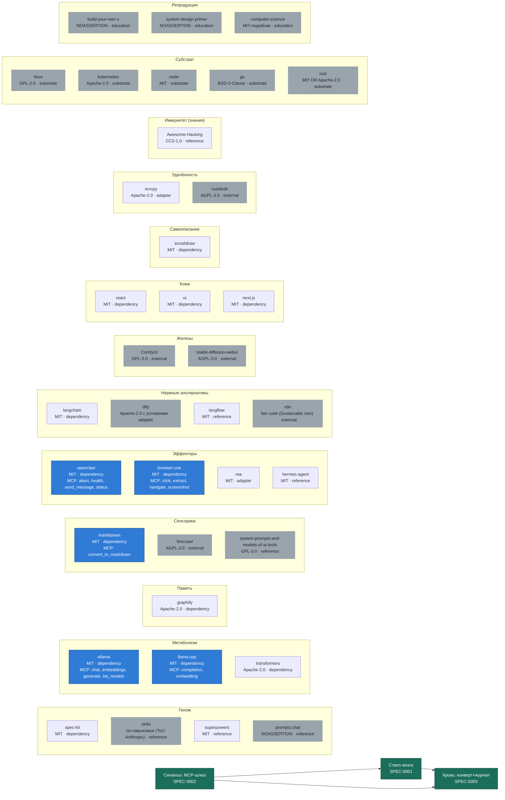

# Самоописание организма

<!-- AUTO-GENERATED: python3 scripts/selfmap.py — ручные правки запрещены, правь реестры -->

Сгенерировано из живых реестров: `organs/registry.yaml` + `synapse/mcp-manifest.yaml`.

## Легенда

- **Зелёный** — собственный код ядра (спеки SPEC-0001..0003).
- **Синий** — органы, объявленные в манифесте синапсов (доступны телу).
- **Серый пунктир** — внешний узел, субстрат или обучение: в тело не входит.

Регенерация: `python3 scripts/selfmap.py`.
